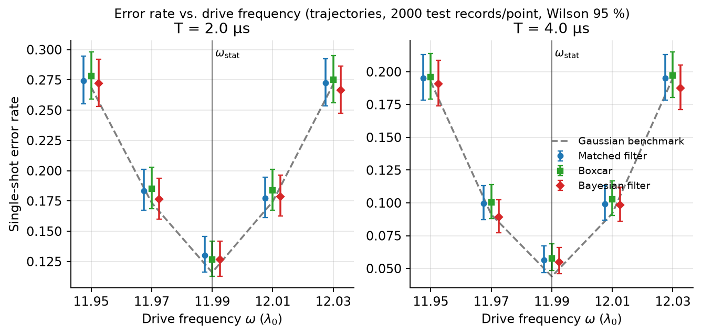
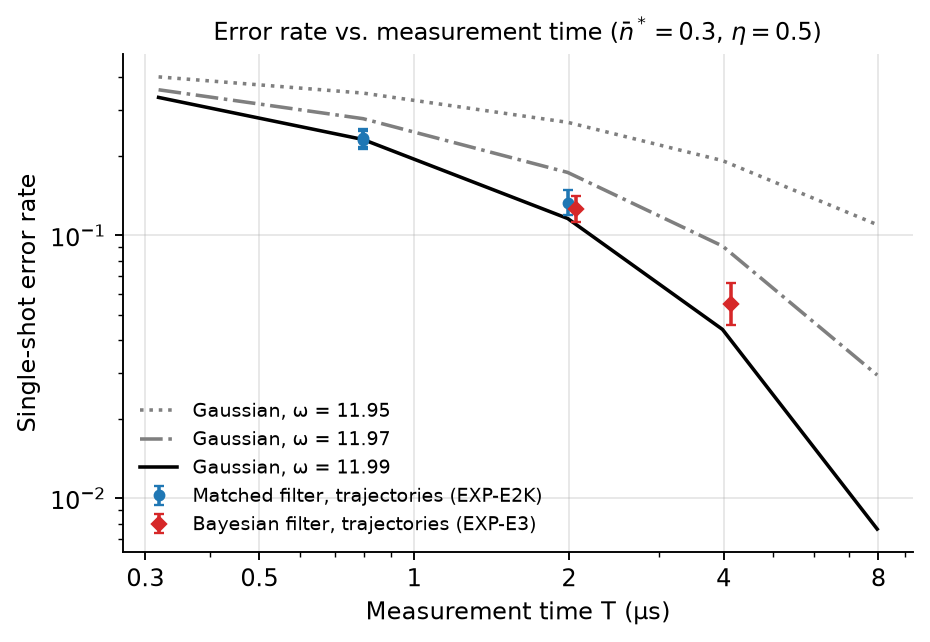
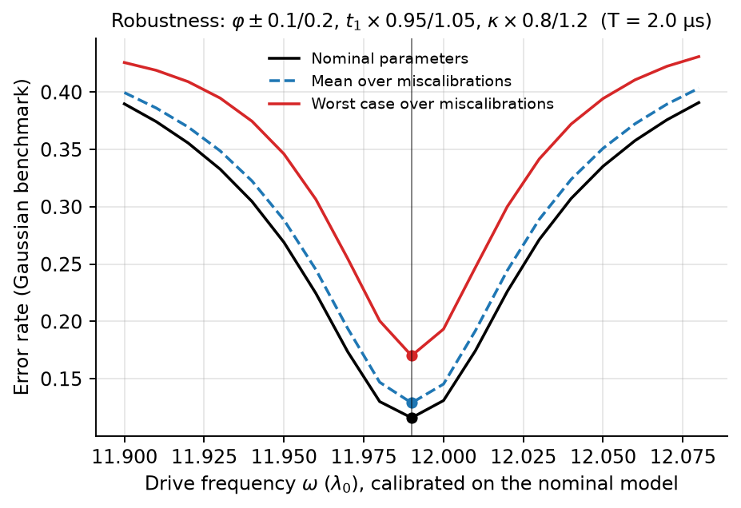

# ParityReadoutLab — Finite-Time Majorana Parity Readout

**Does the drive frequency that maximises the *steady-state* parity contrast of a Majorana box qubit also minimise the *single-shot error* of a finite, inefficient homodyne measurement?**

In a validated open-system model of a Majorana box coupled to a double quantum dot and a microwave resonator (Benjadi & Egger, PRB 2026), the answer is **yes**. The stationary choice of drive frequency is also optimal at finite measurement time, under the real (non-Gaussian) measurement statistics, with a Bayes-optimal decoder, and under parameter miscalibration. A plain linear matched filter loses at most about 1 percentage point against the Bayesian filter.

This is a **pre-registered null result** with quantified error rates, not a claim that stationary optimisation is sufficient in general.

> Folder, file and test names are German; documentation in `02_FORSCHUNGSDOKUMENTATION/` is German. This README summarises it in English.

## Key results

### 1. The stationary working point stays optimal for every decoder



Single-shot error rate from stochastic-master-equation trajectories (2000 test records per point, Wilson 95 % intervals) at T = 2 µs and 4 µs. Matched filter, boxcar filter and the Bayesian filter (log-likelihood ratio from two conditional states, no calibration) all have their minimum at ω_stat = 11.99 λ₀. The Bayesian advantage over the matched filter is at most 1.05 pp, and their intervals never separate.

### 2. Error rate vs. measurement time



The Gaussian SNR benchmark (lines) agrees with the trajectories except at the resonance point, where the qubit is most saturated. There it is about 1.2–1.4 pp optimistic. The working-point choice is unaffected.

### 3. Robustness to miscalibration



The working point is calibrated on the nominal model and evaluated with flux phase φ ± 0.1/0.2, t₁ × 0.95/1.05 and κ × 0.8/1.2 (Gaussian benchmark). Miscalibration raises the error rate (0.116 → 0.170 worst case at T = 2 µs) but does not move the optimum. The regret is zero for both resonator budgets and T ∈ {2, 4, 8} µs.

| ω (λ₀) | T | Gaussian | Matched filter | Boxcar | Bayesian |
|---|---|---|---|---|---|
| 11.95 | 2 / 4 µs | .269 / .192 | .274 / .195 | .278 / .196 | .272 / .191 |
| 11.97 | 2 / 4 µs | .174 / .091 | .183 / .100 | .185 / .100 | .176 / .089 |
| **11.99** | 2 / 4 µs | .116 / .044 | **.130 / .056** | **.127 / .058** | **.127 / .055** |
| 12.01 | 2 / 4 µs | .174 / .092 | .177 / .099 | .184 / .103 | .179 / .098 |
| 12.03 | 2 / 4 µs | .271 / .195 | .273 / .195 | .275 / .197 | .266 / .188 |

## Scope and limits

- **Model:** effective Majorana box–double dot–resonator model in the rotating-wave approximation with Lindblad dissipation. Parameters follow the strong-coupling set of Benjadi & Egger (t₀ = 5, t₁ = 1, λ = 0.1, κ = 0.04, Γ_φ = 0.1, γ = 0.003, 30 mK, in units of λ₀ = h · 0.2 GHz; 1/λ₀ ≈ 0.8 ns).
- **Measurement:** homodyne detection with efficiency η = 0.5, mean resonator occupation n̄* = 0.3.
- **One working-point parameter** (drive frequency) and one parameter regime. Weak coupling, pulse shaping, combined drifts and quasiparticle poisoning are not studied.
- The exact reference curves of the paper are **not** reproduced (missing drive intensity and cutoff; finding F-1.3). The semiclassical reference curves (Fig. 3a/e) are reproduced to better than 1e-4. All finite-time results build on the independently validated core, not on the paper's exact curves.

## How the results were obtained

- **Pre-registration:** each experiment (`02_FORSCHUNGSDOKUMENTATION/_03_EXPERIMENTE/EXP-*.md`) states its question, grid, statistics and decision rule before any computation.
- **Findings register** (`02_FORSCHUNGSDOKUMENTATION/07_BEFUNDE.md`) with explicit status labels: VERIFIED / REPRODUCED / HYPOTHESIS / OPEN / FAILED / BLOCKED. Negative results and failed runs stay documented.
- **A documented failure:** the first run of the main experiment (EXP-E3, run 1) was invalid. A linearised Rouchon–Ralph step was too coarse away from resonance and produced an apparent matched filter *below* the Gaussian bound, which is impossible. The integrator now uses the exact non-Hermitian propagator. Validation VAL9 guards against this case and fails with the old step (finding F-3.4).
- **58 automated checks:** 37 unit tests and 21 scientific validations (VAL0–VAL9), covering the steady state against independent solvers, cutoff convergence, a dispersive SNR reference (Smith et al. 2020), the trajectory ensemble against the master equation, and the Bayesian filter in the linear limit.

## Reproducing

Requires Python 3.12. Pinned dependencies are in `01_PRL_CODE/_05_INFRASTRUKTUR/requirements-lock.txt` (NumPy 2.5, SciPy 1.18, QuTiP 5.3, Matplotlib 3.11). On Linux/macOS replace `Scripts/` with `bin/`.

```bash
python -m venv _UMGEBUNG/venv
_UMGEBUNG/venv/Scripts/python -m pip install -r 01_PRL_CODE/_05_INFRASTRUKTUR/requirements-lock.txt
cd 01_PRL_CODE
../_UMGEBUNG/venv/Scripts/python -B -m _05_INFRASTRUKTUR.run_checks --scope all   # all 58 checks (~5 min)
../_UMGEBUNG/venv/Scripts/python -B -m _08_ERGEBNISSE.abbildungen_readme           # README figures from committed CSVs
```

Experiment scripts live in `01_PRL_CODE/_08_ERGEBNISSE/` (`exp_e3_bayes_arbeitspunkt.py`, `exp_e4_robustheit.py`, …). The full trajectory runs take hours on a desktop CPU. Their processed outputs are committed in `11_Processed_Outputs/`, together with a provenance manifest per run.

## Repository layout

| Path | Content |
|---|---|
| `01_PRL_CODE/_01_GRUNDLAGEN_FORMELN/` | Units, RWA operators, derived quantities, semiclassical formulas |
| `01_PRL_CODE/_02_AUSFUEHRUNG/` | Steady-state solver, homodyne SME integrator, Bayesian filter |
| `01_PRL_CODE/_03_WISSENSCHAFTLICHE_PRUEFUNGEN/` | Scientific validations VAL0–VAL9 |
| `01_PRL_CODE/_04_AUSWERTUNG_DIAGNOSTIK/` | Decoders, error metrics, Wilson intervals |
| `01_PRL_CODE/_05_INFRASTRUKTUR/` | Configuration, provenance, test runner, dependencies |
| `01_PRL_CODE/_06_TESTS/` | Unit tests |
| `01_PRL_CODE/_08_ERGEBNISSE/` | Experiment and figure scripts |
| `01_PRL_CODE/SCHWELLEN.md` | Every numerical tolerance with its justification |
| `02_FORSCHUNGSDOKUMENTATION/` | Research plan, conventions, findings, experiment registrations, stage reports |
| `03_Quellen/Referenzdaten_Zenodo_20623730/` | Reference data of Benjadi & Egger (CC-BY-4.0), with checksums |
| `11_Processed_Outputs/` | Processed results per run |
| `abbildungen/` | Figures of this README |

Start reading at `02_FORSCHUNGSDOKUMENTATION/_04_BERICHTE/ETAPPE_3_BERICHT.md` (stage 3 report) and `02_FORSCHUNGSDOKUMENTATION/07_BEFUNDE.md` (findings).

## References and data

- S. M. Benjadi, R. Egger, *Parity readout in Majorana box qubits from the dispersive to the resonant regime*, Phys. Rev. B (2026), [arXiv:2603.06482](https://arxiv.org/abs/2603.06482).
- Reference data: S. M. Benjadi, R. Egger, Zenodo (2026), [doi:10.5281/zenodo.20623730](https://doi.org/10.5281/zenodo.20623730), licensed CC-BY-4.0, included unmodified in `03_Quellen/`.

This is independent work, not affiliated with or endorsed by the authors of the reference paper.

## License

Code: MIT (see `LICENSE`). Documentation and figures: CC-BY-4.0. Third-party reference data keeps its original license (CC-BY-4.0, Benjadi & Egger).
